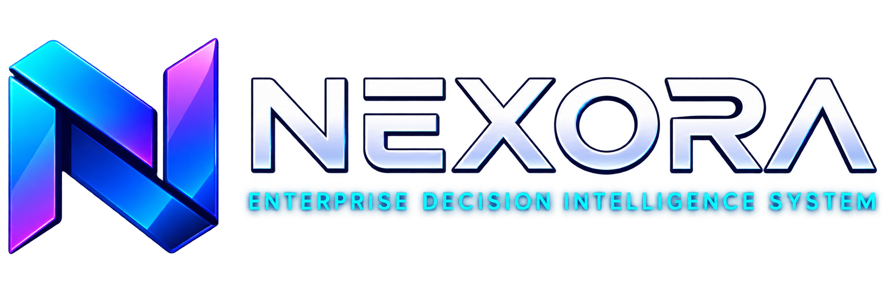

# Nexora Backend



**The Enterprise AI Decision Intelligence Platform**

*From business data to intelligent decisions.*


[**Live API Documentation**](https://the-enterprise-ai-decision-intelligence.onrender.com/docs) · [**ReDoc**](https://the-enterprise-ai-decision-intelligence.onrender.com/redoc) · [**Live Platform**](https://nexoratas.vercel.app/) · [**Source Repository**](https://github.com/annnuspeaks/the-enterprise-ai-decision-intelligence-platform)

---

## Overview

The Nexora backend is the platform's API and application-processing layer. Built with **FastAPI**, it receives frontend requests, validates incoming data, coordinates application logic and machine-learning inference, and returns structured responses to the client.

The backend is deployed on **Render** and communicates with the Nexora frontend hosted on **Vercel**. Model artifacts are maintained with the project backend rather than relying on a separate external model-storage service.

> **Documentation scope:** This README covers backend architecture, API usage, configuration, local development, deployment, and troubleshooting. Dataset preparation, feature engineering, training experiments, and detailed model evaluation belong in the documentation for each individual model.

## Quick Links

| Resource | Link |
|---|---|
| Live backend | [the-enterprise-ai-decision-intelligence.onrender.com](https://the-enterprise-ai-decision-intelligence.onrender.com) |
| Interactive Swagger UI | [Open `/docs`](https://the-enterprise-ai-decision-intelligence.onrender.com/docs) |
| ReDoc API reference | [Open `/redoc`](https://the-enterprise-ai-decision-intelligence.onrender.com/redoc) |
| Live frontend | [nexoratas.vercel.app](https://nexoratas.vercel.app/) |
| GitHub repository | [the-enterprise-ai-decision-intelligence-platform](https://github.com/annnuspeaks/the-enterprise-ai-decision-intelligence-platform) |

*If the hosted service is starting after an idle period, allow a short time for it to wake up before retrying a request.*

## Current Model Integration Status

Nexora is being developed incrementally. The current platform milestone includes four model workflows.

| Model | Capability | Status |
|---|---|---|
| Model 01 — Customer Segmentation | Groups customers into segments using customer-level features | Integrated |
| Model 02 — Customer Churn Prediction | Estimates customer churn risk | Integrated |
| Model 03 — Customer Lifetime Value (CLV) Prediction | Estimates customer lifetime value | Integrated |
| Model 04 — Purchase Propensity Prediction | Estimates purchase likelihood from session and acquisition features | Integrated |
| Models 05–08 | Additional planned model capabilities | Upcoming |

The exact endpoint paths, request schemas, and response structures exposed by the running deployment should be checked in the [live Swagger documentation](https://the-enterprise-ai-decision-intelligence.onrender.com/docs). This avoids relying on outdated local URLs or assuming that every model uses the same input fields.

## Architecture

```text
┌──────────────────────────────┐
│      Nexora React Frontend   │
│          Vercel              │
└──────────────┬───────────────┘
               │ HTTPS / JSON
               ▼
┌──────────────────────────────┐
│       FastAPI Backend        │
│          Render              │
├──────────────────────────────┤
│ API Routes and Validation    │
│ Application / Service Logic  │
│ ML Inference Integration     │
│ Configuration and Logging    │
└──────────────┬───────────────┘
               │
               ▼
┌──────────────────────────────┐
│   Model Artifacts / Results  │
│   Structured JSON Response   │
└──────────────────────────────┘
```

### Request lifecycle

1. The frontend sends an HTTPS request to the backend API.
2. FastAPI routes the request to the relevant endpoint.
3. The request data is validated against the endpoint's expected schema.
4. The application invokes the required service or model-inference workflow.
5. The backend formats the result as a JSON response.
6. The frontend presents the result to the user.

This separation keeps UI concerns in the frontend and prediction processing on the backend.

## Technology Stack

| Component | Technology |
|---|---|
| API framework | FastAPI |
| Language | Python |
| ASGI server | Uvicorn |
| Request validation and settings | Pydantic / Pydantic Settings |
| API format | REST over HTTP(S), JSON |
| Frontend integration | React frontend hosted on Vercel |
| Backend deployment | Render |
| API documentation | Swagger UI and ReDoc |

## Backend Project Structure

The repository's backend is organized around the application entry point, API routes, configuration, and machine-learning integration.

```text
backend/
├── app/
│   ├── api/                 # API routes and router registration
│   ├── core/                # Application configuration and logging
│   ├── ml/                  # Model loading and inference integration
│   ├── main.py              # FastAPI application entry point
│   └── ...                  # Additional application modules
├── data/                    # Backend-side data resources, where applicable
├── logs/                    # Runtime/application logs, where configured
├── models/                  # Model artifacts used by backend inference
├── notebooks/               # Existing development notebooks, if applicable
├── requirements.txt          # Python dependencies
├── README.md                 # Backend documentation
└── run.py                    # Existing runner, if used by the project
```

The exact contents may evolve as the project develops. Keep model-specific training notebooks and research documentation separate from production API logic where practical.

## API Documentation and Endpoints

FastAPI publishes interactive documentation from the deployed application:

- **Swagger UI:** [https://the-enterprise-ai-decision-intelligence.onrender.com/docs](https://the-enterprise-ai-decision-intelligence.onrender.com/docs)
- **ReDoc:** [https://the-enterprise-ai-decision-intelligence.onrender.com/redoc](https://the-enterprise-ai-decision-intelligence.onrender.com/redoc)

Use these pages to inspect the endpoints currently registered in the deployed API, including HTTP methods, required fields, validation rules, response schemas, and error responses.

### Example request

The following example illustrates the request pattern for the Customer Segmentation API. Use the live API documentation to confirm the latest schema before testing.

```bash
curl -X POST \
  "https://the-enterprise-ai-decision-intelligence.onrender.com/customer-segmentation/predict" \
  -H "Content-Type: application/json" \
  -H "Accept: application/json" \
  -d '{
    "total_orders": 12,
    "total_spent": 1850.75,
    "average_order_value": 154.23,
    "average_review_score": 4.6
  }'
```

A successful response is expected to use JSON. The exact output fields are defined by the active endpoint implementation and can be inspected in Swagger UI.

## Configuration and Environment Variables

Application settings are centralized through the backend configuration layer. Environment-specific values should be supplied through environment variables or an appropriate local `.env` file rather than hard-coded into source code.

### Frontend API base URL

The deployed frontend uses the following production API base URL:

```env
VITE_API_BASE_URL=https://the-enterprise-ai-decision-intelligence.onrender.com
```

Set this variable in the frontend's Vercel project, then redeploy the frontend for the change to take effect. Do not add the `VITE_` variable to the backend unless the backend code explicitly requires it.

### CORS

The backend uses FastAPI's `CORSMiddleware` with origins supplied through application settings. The deployed configuration must allow the actual frontend origin:

```text
https://nexoratas.vercel.app
```

If the frontend is also served from another production domain or preview deployment, add only the origins that are genuinely required. Avoid using unrestricted origins as a production shortcut, particularly when credentials are enabled.

### Secrets and credentials

- Never commit real credentials, API keys, or private environment files.
- Keep production configuration in the hosting provider's environment-variable settings.
- If a credential is accidentally exposed, revoke or rotate it.
- Do not log secrets or sensitive request data.

## Run Locally

### Prerequisites

- Python installed
- `pip`
- Git
- A terminal or IDE such as Visual Studio Code

### 1. Open the backend directory

Run these commands from the repository root:

```bash
cd backend
```

### 2. Create and activate a virtual environment

**Windows — Command Prompt:**

```bat
python -m venv .venv
.venv\Scripts\activate
```

**Windows — PowerShell:**

```powershell
python -m venv .venv
.\.venv\Scripts\Activate.ps1
```

**macOS / Linux:**

```bash
python3 -m venv .venv
source .venv/bin/activate
```

### 3. Install dependencies

```bash
python -m pip install --upgrade pip
pip install -r requirements.txt
```

### 4. Start the development server

```bash
uvicorn app.main:app --reload
```

By default, the local development server is available at:

- API base: `http://127.0.0.1:8000`
- Swagger UI: `http://127.0.0.1:8000/docs`
- ReDoc: `http://127.0.0.1:8000/redoc`

These are **local development URLs only**. Use the hosted Render URLs above when accessing the production backend.

## Deployment on Render

The backend is deployed as a Python web service on Render.

Typical service configuration for this repository layout:

| Setting | Value |
|---|---|
| Root Directory | `backend` |
| Build Command | `pip install -r requirements.txt` |
| Start Command | `uvicorn app.main:app --host 0.0.0.0 --port $PORT` |

Before deploying, verify that:

1. `backend/requirements.txt` contains every dependency imported by the backend.
2. The configured root directory is `backend`.
3. The model artifacts required at runtime are included in the repository/deployment bundle at the paths expected by the model loader.
4. The deployed service has the required environment variables.
5. The configured CORS origins include the production frontend.
6. The start command points to `app.main:app`.
7. The deployed Swagger UI loads and the prediction endpoints return expected responses.

The actual service settings in Render remain the source of truth if they differ from this suggested configuration.

## Frontend Integration

The React frontend calls the backend through the configured API base URL. Keep the base URL centralized in the frontend configuration so that local development and production can use different backends without changing individual model screens.

When diagnosing a failed prediction, check the following in order:

1. Open the endpoint directly in the live Swagger UI.
2. Submit a valid request using the schema shown there.
3. Confirm the backend returns the expected HTTP status and JSON body.
4. Open the browser's Developer Tools → **Network** and inspect the failing request.
5. Check the browser console for CORS errors.
6. Verify `VITE_API_BASE_URL` in Vercel and redeploy after changing it.
7. Inspect the Render service logs for model-loading, validation, or runtime errors.

A backend endpoint returning `200 OK` in Swagger does not, by itself, prove that the browser request is succeeding. CORS configuration, frontend request payloads, or a stale frontend deployment can still cause the UI workflow to fail.

## Validation, Logging, and Error Handling

### Request validation

Request schemas define the expected structure and types of incoming data. Invalid payloads should be rejected before reaching model inference, helping keep API behavior predictable.

### Logging

Application logging supports startup diagnostics, runtime troubleshooting, and investigation of unexpected failures. Logs should be useful without exposing credentials or unnecessary personal or sensitive data.

### Error handling

When a request fails, inspect the HTTP status and response body rather than relying only on the frontend's generic error message. Common causes include:

- invalid or missing request fields;
- a model artifact missing from the deployed bundle;
- a model-loading or inference exception;
- an incorrect API base URL;
- a CORS preflight failure;
- or a deployment that has not yet picked up the latest configuration.

## Testing Checklist

Use this checklist after backend changes or a production deployment.

- [ ] Backend service starts without import errors.
- [ ] Live Swagger UI is accessible.
- [ ] All four current model endpoints are visible in the API documentation.
- [ ] Each model accepts a valid request and returns the expected response.
- [ ] Invalid payloads return a meaningful HTTP error.
- [ ] The frontend uses the correct production API base URL.
- [ ] Browser requests pass CORS checks.
- [ ] Render logs contain no unresolved model-loading or inference errors.
- [ ] No secrets or local-only configuration files are committed.

## Security and Future Expansion

The backend is structured to support additional platform capabilities as the project evolves. Authentication, authorization, rate limiting, database integrations, background jobs, and audit logging should be described as implemented only after they have been added and verified.

Recommended production practices include input validation, least-privilege configuration, restricted CORS origins, secret management, dependency maintenance, and useful operational logging.

## Viva / Project Review Notes

**What is the backend's role in Nexora?**  
It exposes APIs, validates requests, runs application logic and model inference, and returns structured results to the frontend.

**Why FastAPI?**  
FastAPI supports typed request validation, automatic interactive API documentation, and a modular Python API structure.

**How does the frontend communicate with it?**  
The frontend sends HTTPS requests to the backend and exchanges JSON data through REST endpoints.

**Why are the model training details separate?**  
The backend README explains how the deployed API integrates the models. Dataset choices, training methodology, and evaluation belong to each model's own documentation.

**How should a prediction failure be debugged?**  
First test the endpoint and payload in Swagger UI, then inspect the browser Network panel and console, verify the frontend API URL and CORS settings, and check Render logs.

## Architecture at a Glance

```text
React Frontend
      │
      ▼
HTTPS / REST API
      │
      ▼
FastAPI Routing
      │
      ▼
Request Validation
      │
      ▼
Application Logic
      │
      ▼
Model Inference (when required)
      │
      ▼
Structured JSON Response
```

---

**Nexora — The Enterprise AI Decision Intelligence Platform**

*From business data to intelligent decisions.*

