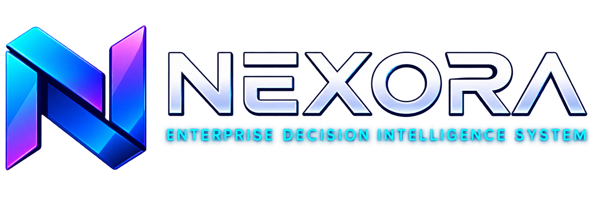

<p align="center">
  
</p>

<h1 align="center">Nexora — Frontend</h1>

<p align="center">
  <strong>The Enterprise AI Decision Intelligence Platform</strong><br />
  From business data to intelligent decisions.
</p>

<p align="center">
  <a href="https://nexoratas.vercel.app/">Live Platform</a> ·
  <a href="https://the-enterprise-ai-decision-intelligence.onrender.com/docs">Backend API Docs</a> ·
  <a href="https://github.com/annnuspeaks/the-enterprise-ai-decision-intelligence-platform">Source Repository</a>
</p>

---

## Overview

The Nexora frontend is the user-facing web application for an enterprise-oriented AI decision intelligence platform. It provides a consistent interface for entering business data, submitting prediction requests, and reviewing model-generated insights.

The frontend is a React single-page application (SPA) that communicates with the Nexora FastAPI backend over HTTP. The backend performs model inference; the frontend manages the user experience, request submission, and presentation of returned results.

> **Implementation status:** Models 01–04 are the current model integrations. Models 05–08 are planned capabilities and should not be treated as implemented until their workflows are released.

## Live Environments

| Resource | URL |
|---|---|
| Frontend application | [nexoratas.vercel.app](https://nexoratas.vercel.app/) |
| Backend service | [Render API](https://the-enterprise-ai-decision-intelligence.onrender.com) |
| Interactive API documentation | [Swagger UI](https://the-enterprise-ai-decision-intelligence.onrender.com/docs) |
| OpenAPI schema | [openapi.json](https://the-enterprise-ai-decision-intelligence.onrender.com/openapi.json) |
| Source repository | [GitHub](https://github.com/annnuspeaks/the-enterprise-ai-decision-intelligence-platform) |

The frontend is deployed on Vercel and the API is hosted separately on Render. Configure the production API base URL through the frontend environment settings.

## Model Portfolio

Nexora is being developed incrementally, with each model integrated as a distinct business workflow.

| Model | Capability | Status |
|---|---|---|
| **Model 01** | Customer Segmentation | Integrated |
| **Model 02** | Customer Churn Prediction | Integrated |
| **Model 03** | Customer Lifetime Value (CLV) Prediction | Integrated |
| **Model 04** | Purchase Propensity Prediction | Integrated |
| **Model 05** | Upcoming model capability | Planned |
| **Model 06** | Upcoming model capability | Planned |
| **Model 07** | Upcoming model capability | Planned |
| **Model 08** | Upcoming model capability | Planned |

The exact scope and names of Models 05–08 should be added when those capabilities are confirmed and implemented. Planned entries are not live prediction workflows.

## Technology Stack

- **React** — component-based user interface
- **TypeScript** — typed application code
- **Vite** — development server and production build tooling
- **Material UI (MUI)** — interface components and layout primitives
- **HTTP API integration** — communicates with the FastAPI backend
- **Vercel** — frontend deployment

For exact dependency versions and available scripts, refer to `package.json`.

## Architecture and Request Flow

```text
User
  |
  v
Nexora React + TypeScript Frontend
  |  Collects and validates form input
  v
Frontend API Client
  |  Sends an HTTP request to the configured API base URL
  v
Nexora FastAPI Backend (Render)
  |  Validates input and runs the selected model
  v
JSON Prediction Response
  |
  v
Frontend Result View
```

The frontend does not train models or load model artifacts in the browser. Prediction and inference logic belong to the backend service.

## Getting Started

### Prerequisites

- Node.js (an active LTS release is recommended)
- npm (included with Node.js)
- Git

### 1. Clone the repository

Run the following commands in a terminal:

```bash
git clone https://github.com/annnuspeaks/the-enterprise-ai-decision-intelligence-platform.git
cd the-enterprise-ai-decision-intelligence-platform/frontend
```

### 2. Install dependencies

```bash
npm install
```

### 3. Configure environment variables

Create a local `.env` file inside `frontend/`. Use `.env.example` as a reference if it exists.

For the deployed backend:

```env
VITE_API_BASE_URL=https://the-enterprise-ai-decision-intelligence.onrender.com
```

For local backend development only:

```env
VITE_API_BASE_URL=http://127.0.0.1:8000
```

Use the production URL for the deployed frontend. The `127.0.0.1` address points to the user's own computer and must not be used as the production API URL.

Vite exposes variables prefixed with `VITE_` to browser-side code. Never store private keys, tokens, or server secrets in these variables.

Restart the development server after changing `.env`.

### 4. Start the development server

```bash
npm run dev
```

Open the local URL printed in the terminal.

### 5. Create a production build

```bash
npm run build
```

### 6. Preview the production build

```bash
npm run preview
```

Check `package.json` for the scripts supported by the current repository version.

## Environment Configuration

| Variable | Required | Purpose |
|---|---|---|
| `VITE_API_BASE_URL` | Yes | Base URL used by the frontend API client |

Production example:

```env
VITE_API_BASE_URL=https://the-enterprise-ai-decision-intelligence.onrender.com
```

Configuration notes:

- Set the variable in Vercel for the required deployment environments.
- Trigger a new deployment after changing Vercel environment variables.
- Set the value to the API origin; route paths should be appended by the API client or feature service.
- Avoid trailing-slash inconsistencies if the API client does not normalize the base URL.
- Never place credentials or server-side secrets in `VITE_*` variables.

## Backend Integration and Troubleshooting

The production API and interactive documentation are available here:

- **API base:** [Render API](https://the-enterprise-ai-decision-intelligence.onrender.com)
- **Swagger UI:** [API documentation](https://the-enterprise-ai-decision-intelligence.onrender.com/docs)

Use Swagger UI to inspect the deployed routes, request schemas, and response formats. It is the reference for the currently deployed API contract.

### If a prediction fails

1. Open the browser Developer Tools.
2. Select **Network** and submit the prediction again.
3. Open the failed request and inspect its **Request URL**, **Status Code**, and **Response**.
4. Confirm `VITE_API_BASE_URL` points to the Render API origin, not `127.0.0.1` in production.
5. If the console reports a CORS error, verify that the backend allows the exact deployed frontend origin.
6. Check the Render service logs for server-side errors.
7. Compare the frontend payload with the request schema shown in Swagger UI.

A `200 OK` response when an endpoint is tested directly does not guarantee that browser integration is working. The browser request can still fail because of CORS, an incorrect URL, a payload mismatch, or frontend response handling.

## CORS and Deployment

The backend must allow the exact production frontend origin, including its scheme and hostname. For example:

```text
https://nexoratas.vercel.app
```

If the frontend uses another production domain or a Vercel preview URL, configure that origin according to the backend's CORS policy. Do not combine a wildcard origin with credentialed requests.

Recommended release sequence:

1. Set `VITE_API_BASE_URL` in Vercel.
2. Confirm the Render backend is running and its `/docs` page opens.
3. Build and deploy the frontend.
4. Test each implemented model workflow in the browser.
5. Inspect the browser Network and Console panels for failed requests.
6. Verify that the deployment uses the intended commit and environment configuration.

## Project Structure

The repository's current files are the source of truth. At a high level, the frontend contains application entry points, assets, UI components, and model workflows.

```text
frontend/
├── public/              # Public static assets, if present
├── src/
│   ├── assets/          # Nexora logo, icon, and other assets
│   ├── components/      # Shared UI components, if present
│   ├── pages/           # Page-level views, if present
│   ├── services/        # API client/helpers, if present
│   ├── App.tsx          # Application shell
│   └── main.tsx         # Frontend entry point
├── .env.example         # Environment template, if present
├── package.json         # Scripts and dependencies
├── tsconfig.json        # TypeScript configuration
└── vite.config.ts       # Vite configuration
```

This is an illustrative overview; optional directories may differ between revisions.

## Development Guidelines

- Keep API communication in the existing API client/service layer.
- Align model forms and result views with the backend's request and response schemas.
- Provide clear loading, success, empty, and error states.
- Never replace failed API responses with fabricated prediction values.
- Use clear labels and validation messages for business users.
- Maintain consistent spacing, typography, accessibility, and responsive behavior.
- Update the Model Portfolio table when model capabilities are actually released.

## Release Checklist

- [ ] Dependencies install successfully.
- [ ] `npm run build` completes without errors.
- [ ] The deployed frontend loads without runtime errors.
- [ ] `VITE_API_BASE_URL` points to the intended backend.
- [ ] The deployed backend's `/docs` page is reachable.
- [ ] Each implemented model sends the expected request payload.
- [ ] Successful responses display the expected result.
- [ ] Failed requests show a useful error message.
- [ ] CORS works from the production frontend origin.
- [ ] Desktop and mobile layouts remain usable.
- [ ] Documentation links and model statuses match the current release.

## Related Documentation

- [Main platform README](../README.md)
- [Backend README](../backend/README.md)
- [Interactive API documentation](https://the-enterprise-ai-decision-intelligence.onrender.com/docs)
- [OpenAPI schema](https://the-enterprise-ai-decision-intelligence.onrender.com/openapi.json)

If a linked README does not exist in the current branch, update the link when that documentation file is added.

## License

This project is distributed under the repository's [MIT License](../LICENSE). See the root `LICENSE` file for the complete terms.
